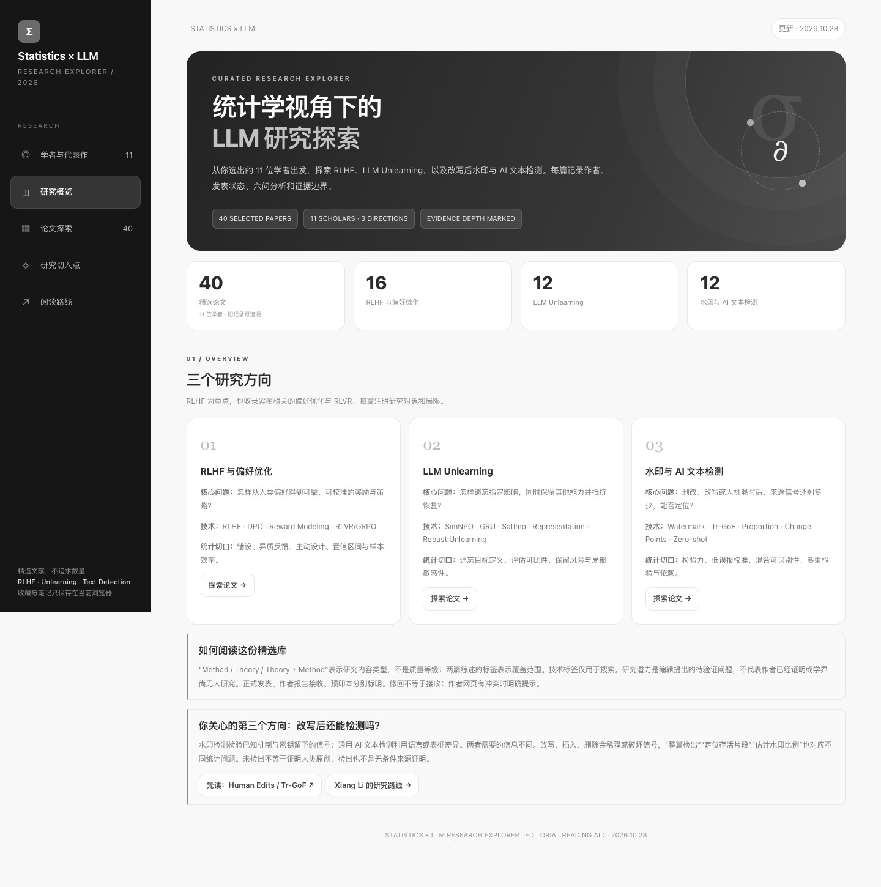

# Statistics × LLM Research Explorer

**[公开探索网站](https://zbchen16.github.io/rlhf-statistics-atlas/)**

从用户选出的 **11 位学者**进入三个方向：**RLHF 与偏好优化 16 篇、LLM Unlearning 12 篇、水印与 AI 文本检测 12 篇**。主库共 **40 篇精选论文**，不是所有学者的完整发表目录。每篇包含完整作者、学者关联、发表状态与依据、六问分析和证据边界。[文献选择报告](docs/SELECTED_PAPERS_REPORT.md)。



## 浏览与个人记录

研究概览、学者与代表作、论文探索、七个研究切入点和四阶段阅读路线。支持作者/关键词搜索，学者/方向/来源/年份/类型筛选，收藏、已读、笔记、最多四篇比较，以及 CSV、笔记与路线导出。黑白界面适配移动端。

笔记仅保存在当前浏览器 localStorage。旧存储 key 与论文 ID 保留，归档笔记仍可查看、编辑和导出；没有云同步。网站用于探索检测论文，不是文本检测服务。

## 维护

主库唯一权威数据源为 `public/data/papers.json`。人物入口在 `public/data/scholars.json`。转出的 55 条旧记录保存在 `papers_archive.json`，原 58 个 ID 均可追溯。旧 ID 不得用于另一篇论文。

修改 JSON 后执行：

```sh
python3 scripts/sync_papers.py
python3 scripts/verify_site.py
```

HTML 内数据和 CSV 为生成副本，支持直接打开 HTML 离线浏览。阅读路线和研究建议在 HTML 内，修改关联 ID 时需一起核对。添加学者需更新人物资料与核查规则。

本地预览：`python3 -m http.server 8766 --bind 127.0.0.1 --directory public`。浏览器检查：在已具备 Playwright 和 Chromium 的环境运行 `node scripts/browser_smoke.cjs`；可用 `ATLAS_TEST_URL` 指定站点。测试使用独立上下文，不接触真实浏览器笔记。

## 证据边界

核查截至 **2026-10-28**。所有精选条目核对 arXiv 作者、题名和摘要；正式发表、作者报告接收与预印本分别注明。修回不是接收。未系统审计全文定理或实验数值。两篇综述的研究类型表示覆盖内容。研究切入点是待验证提议。

水印检验依赖特定机制与密钥等条件，通用检测与之不同。编辑、改写和混写可能破坏信号。未检出不能证明人类原创，估计的水印比例也不等于无条件的 AI 创作比例。

## 发布

纯静态 HTML/CSS/JavaScript，无框架、后端、模型 API 或账号系统。GitHub Actions 校验数据并从 `public/` 部署 GitHub Pages。每次发布核查 Actions 与公开 URL，记录在项目任务目录。
