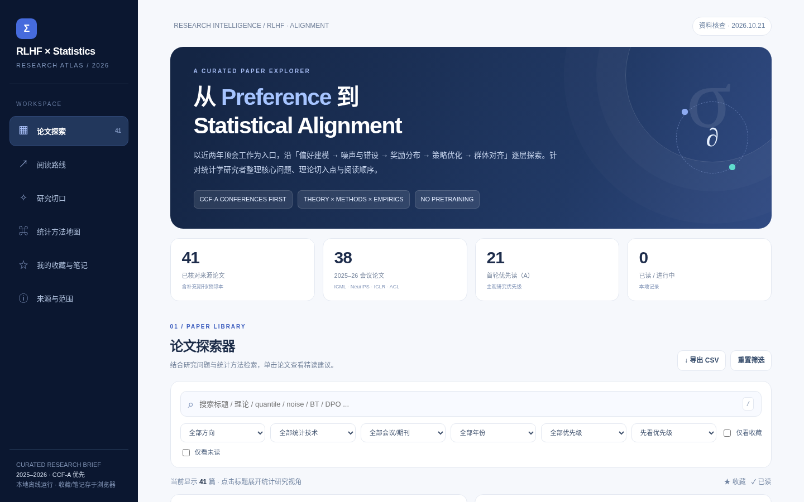
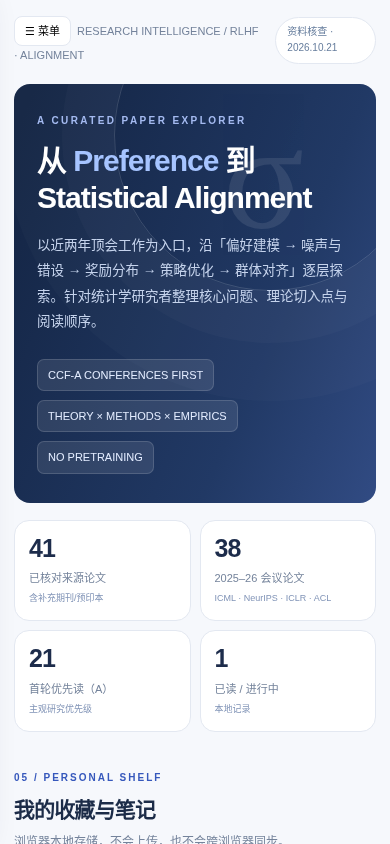

# RLHF × Statistics Research Atlas

**Public site:** https://zbchen16.github.io/rlhf-statistics-atlas/

An interactive, static research atlas of RLHF, preference learning and alignment papers, curated on **2026-10-21**. Prioritizes 2025–2026 conference papers and statistical perspectives; includes a small number of JASA/arXiv reference records.

## Contents

- **41 paper records**, **38 conference papers**, **21 A-priority reading recommendations** (editorial priorities, not CCF venue rankings).
- Interactive search, topic/venue/year/statistical-method filters, a 4-week reading route, six research prompts, side-by-side paper comparison.
- Stars, reading status and reading notes stored in the **visitor’s local browser** via `localStorage`. These are not synced across browsers and are not uploaded to a server.
- No backend, no database, no API keys, and no need to build an Agent.

## Screenshots





## Preview locally

Open `public/index.html` directly in a browser, or run:

```bash
python -m http.server 8000 --directory public
```

Then visit `http://localhost:8000/`.

## Editing bibliography

The **canonical source** is [`public/data/papers.json`](public/data/papers.json). The browser currently embeds the dataset in `public/index.html` so the site can also run offline via `file://`. Edit the JSON, then run:

```bash
python scripts/sync_papers.py
python scripts/verify_site.py
```

This regenerates the HTML snapshot and `public/data/papers.csv`. Don't manually edit three copies independently. CSV is an interchange/export artifact. The reading-route IDs, idea summaries, and narrative counts are manually curated in HTML: if you add or remove papers, review those sections separately. The top dashboard counters are computed by JavaScript at runtime.

## Publish to GitHub Pages

This repository includes [`.github/workflows/pages.yml`](.github/workflows/pages.yml), which checks data consistency and deploys `public/` to GitHub Pages after pushes to `main`. You need to:

1. Push this folder to a **new public GitHub repository** (suggested name: `rlhf-statistics-atlas`). Do not accidentally push unrelated personal files.
2. In repository **Settings → Pages → Build and deployment → Source**, select **GitHub Actions**.
3. Inspect **Actions** to confirm the `Verify and deploy GitHub Pages` workflow succeeds. The resulting URL for a project site normally has the form `https://<owner>.github.io/<repo>/`.
4. Open the public URL (not merely localhost) and test search, filters, paper details, bookmarks, comparison, reading route, mobile viewport, and link navigation.

The publication workflow **is not executed merely by creating these files**. Publication requires your GitHub credentials/repository permissions and a successful GitHub Pages deployment. See [official GitHub Pages docs](https://docs.github.com/en/pages/getting-started-with-github-pages/configuring-a-publishing-source-for-your-github-pages-site).

## Quality and provenance cautions

- Paper summaries and suggested research questions are **editorial interpretation**, not author-verified findings or proofs. Validate each source and publication metadata before relying on them in academic work.
- `A/B/C/S` describe subjective reading priority. They **do not** denote CCF classifications or paper quality scores.
- The instructor’s referenced “quantile regression / distributional RLHF / JASA” article remains **unidentified**. Do not claim the arXiv QRM paper or the JASA distributional OPE paper is definitively that article.
- The collection is frozen at 2026-10-21: it **does not update automatically**.
- Public pages are visible to anyone; avoid publishing private notes, tokens, unpublished manuscripts, or other personal data. Personal browser notes are not part of this repository.
- No open-source license has been selected. A public GitHub repository is not automatically an open-source license grant; add a license only after choosing terms.

## Layout

```
public/
  index.html             # Offline-capable interactive site
  .nojekyll
  data/papers.json       # Canonical bibliography
  data/papers.csv        # Export/snapshot
scripts/
  sync_papers.py         # JSON -> HTML/CSV
  verify_site.py         # Source-consistency checks
.github/workflows/
  pages.yml              # Verify and publish static pages
docs/screenshots/
  desktop.png
  mobile.png
CODEX_DEPLOY_PROMPT.md
README.md
```

## Research scope

Preference models, noisy and heterogeneous feedback, reward model reliability, DPO/RLHF theory, distributional reward modeling, and multi-objective alignment. This is a reading aid, not a systematic literature review. References should be checked before citation.
